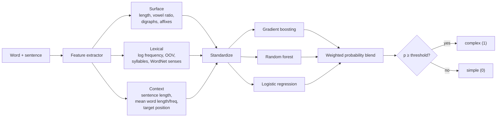
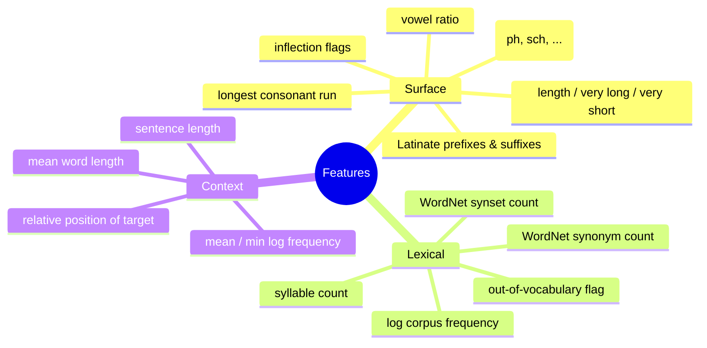

# Complex Word Identification

Decide whether a word is **simple** or **complex** in context. This is the
first stage of a lexical **text-simplification** pipeline: once you know which
words a reader is likely to struggle with, you can swap them for easier
synonyms. Simplification like this helps language learners, younger readers,
and people with reading disabilities.

> `conventional` → **complex**, `everyday` → simple · `plummeted` → **complex**, `fell` → simple

The project ships three interpretable baselines and a learned classifier that
blends gradient-boosted trees, a random forest, and logistic regression over
surface, lexical, and contextual features.

---

## How it works



The decision threshold is tuned on a held-out development split to maximise F1,
rather than being fixed at 0.5.

### Feature groups



---

## Quickstart

```bash
pip install -r requirements.txt          # or: pip install -e .

# train + evaluate on the bundled sample and save the model
python scripts/train.py \
    --train data/sample/train.tsv \
    --dev   data/sample/dev.tsv \
    --out   model.joblib

# label new words (no label column)
python scripts/predict.py \
    --model model.joblib \
    --input data/sample/test.tsv \
    --unlabeled
```

```text
bicycle       simple
pernicious    complex
esoteric      complex
serendipity   complex
```

### Use it as a library

```python
from cwi import ComplexWordClassifier
from cwi.data import load_word_file, load_ngram_counts

counts = load_ngram_counts("data/ngram_counts.txt.gz")  # optional
clf = ComplexWordClassifier(ngram_counts=counts)
clf.fit(load_word_file("data/sample/train.tsv"))
clf.tune_threshold(load_word_file("data/sample/dev.tsv"))

preds = clf.predict(load_word_file("data/sample/test.tsv", labeled=False))
```

---

## Results

Evaluated on the SemEval-2016 Complex Word Identification development set
(positive class = complex). Each model is trained on the training split; the
learned blend sees surface, lexical, and contextual features.

| Model | Precision | Recall | F1 |
| ----- | :-------: | :----: | :--: |
| Majority class | 0.42 | 1.00 | 0.59 |
| Word length threshold | 0.61 | 0.87 | 0.71 |
| Word frequency threshold | 0.56 | 0.84 | 0.67 |
| Gaussian Naive Bayes | 0.47 | 0.97 | 0.63 |
| Logistic regression | 0.73 | 0.69 | 0.71 |
| **Stacked blend (this repo)** | **0.76** | **0.83** | **0.79** |

The blend wins because the two most informative raw signals (word length and
corpus frequency) have very different distributions: length is roughly
unimodal while frequency is extremely heavy-tailed. Linear and Gaussian models
struggle with that skew, whereas the tree ensembles learn non-linear
interactions and the logistic member keeps the boundary stable.

### Where it still trips up

- **Short but conceptually hard words** (`coup`, `pledge`, `atomic`) look simple
  by length and frequency and get missed.
- **Long, familiar news words** (`firefighters`, `elementary`, `businesses`)
  look complex morphologically but are common, so they draw false positives.
- **Hyphenated compounds** (`best-selling`, `blue-collar`) are inconsistent,
  because compounding does not reliably signal complexity to annotators.

---

## Project layout

```
cwi/
├── metrics.py     precision / recall / F1
├── data.py        dataset + n-gram loaders
├── baselines.py   majority, length, and frequency rules
├── features.py    surface + lexical + contextual feature extractor
└── model.py       the stacked ComplexWordClassifier
scripts/
├── train.py       fit, evaluate against baselines, save
└── predict.py     label a word file
data/sample/       small runnable dataset (see data/README.md)
```

See [`data/README.md`](data/README.md) for the file formats and how to plug in
the full corpus and Google n-gram counts.
